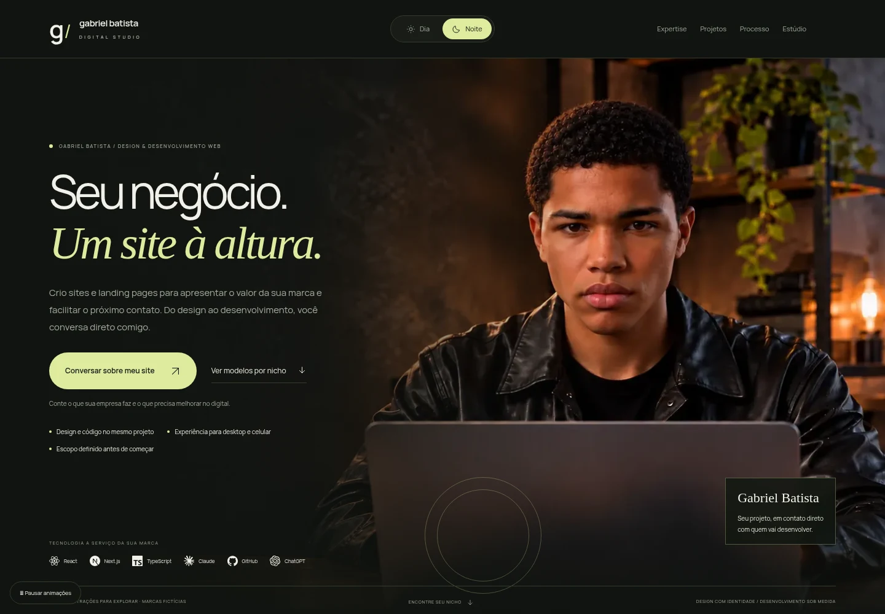

# Gabriel Batista Digital — Studio / direção cinematográfica

Next.js App Router, TypeScript estrito e Tailwind CSS 4. Contato comercial exclusivo: https://wa.me/5538998267717.



[Ver transição no scroll](docs/preview/hero-scroll.gif) · [Versão diurna](docs/preview/home-light.webp) · [Celular](docs/preview/mobile.webp) · [Portfólio](docs/preview/portfolio.webp)

## Executar

Node.js 22+ e npm. Abra a pasta que contém este arquivo e `package.json`.

```sh
npm ci
npm run dev
```

Use a porta que o terminal confirmar. Não inicie cópias concorrentes do mesmo projeto.

```sh
npm run lint
npm run build
npm run typecheck
npm run start
```

## Direção visual e conteúdo

- Hero com nove quadros de abertura frontal a lateral, ligados ao scroll em um canvas opaco. Cada atualização desenha apenas uma imagem, eliminando o rosto duplicado causado pelo antigo dissolve.
- Os quadros intermediários são gerados a partir das imagens aprovadas, não extraídos de filmagem ou 3D. Variações entre poses podem ser percebidas; não há promessa de reconstrução física exata.
- Versões de 1280×720 para desktop e 768×432 para celular. A sequência completa nas duas variantes soma aproximadamente 946 KB. Pausa congela a pose; movimento reduzido/economia de dados mantêm a abertura estática. Sem JS/canvas, a imagem HTML inicial permanece visível.
- O retrato lateral aprovado `public/images/hero/gabriel.png` continua intacto. Gato, luminária e janela artificiais não foram reintroduzidos.
- Dia/Noite altera paleta e gradação; a fotografia não contém objetos de iluminação animáveis separados.
- Portfólio preserva os mockups de desktop/celular e agora mostra capturas atualizadas das demonstrações.
- Chronos: três peças com imagens diferentes, materiais e descrições próprias. Vanguard: três estudos de programa, materialidade e partido distintos. Aura: três etapas de uma jornada de contato, sem diagnóstico, coleta de saúde ou promessa médica.
- Seis novas imagens editoriais, além das três existentes. Nenhuma representa um cliente, produto à venda ou obra executada. Cada demonstração contém três seleções que atualizam imagem, texto e ficha.
- Serviços explicam indicação, entrega e limites. O processo mostra o resultado esperado de cada etapa; FAQ aborda conteúdo, edição, hospedagem, SEO, escopo e natureza dos protótipos.
- Laboratório de scroll, navegação nativa, suporte a teclado, temas e pausa global preservados.

## Arquivos principais

- `app/experience.css`: cena, controle de temas, laboratório e apresentação dos conceitos.
- `components/HeroScene.tsx`: carregamento, desenho opaco e controles da sequência.
- `public/images/hero/frames/`: nove quadros e suas versões móveis.
- `lib/concept-content.ts`: fichas e conteúdo próprio dos nove itens conceituais.
- `components/sections/FAQ.tsx`: dúvidas antes do contato.
- `components/ThemeToggle.tsx`: seleção explícita Dia/Noite.
- `components/ScrollExperience.tsx`: progresso de leitura, capítulos e pausa.
- `components/ExperienceLab.tsx`: transição de wireframe para interface.
- `components/ConceptPhoto.tsx`: imagens dos conceitos nas demonstrações.
- `components/ConceptExplorer.tsx`: exploração interativa de cada conceito.
- `public/images/screens/`: capturas reais das páginas renderizadas, usadas nos mockups.
- `lib/content.ts`: textos, serviços e exatamente três conceitos.
- `lib/site.ts`, `lib/whatsapp.ts`: marca e contato oficial.

## Testes

```sh
npx playwright install chromium
npm run test:e2e
```

Em ambientes com Chromium já instalado, use a variável `PLAYWRIGHT_CHROMIUM_EXECUTABLE` com o caminho local. Não é necessária para instalações comuns do Playwright. Os testes iniciam uma instância temporária de produção na porta 3107, então execute build antes e mantenha essa porta disponível.

A API do assistente antigo permanece desativada por padrão. Não é necessária nenhuma chave para abrir a landing page. Não habilite essa API sem revisar seu comportamento e configuração.

## Instalar a revisão no Antigravity

Veja `INSTRUCOES-ANTIGRAVITY.md`. Prefira abrir o ZIP completo em uma pasta nova: aplicar apenas Hero.tsx deixa os componentes e estilos inconsistentes.

## Galeria de 20 protótipos

Os três conceitos originais continuam em `/conceitos/`. A seção `#modelos` acrescenta 17 páginas completas em `/modelos/[slug]`: advocacia patrimonial, direito do agro, psicologia, odontologia, imóveis, energia solar, dermatologia, medicina, contabilidade, consultoria, seguros, hotelaria, gastronomia, interiores, cibersegurança, educação executiva e logística.

A apresentação usa capturas reais das páginas em janelas verticais roláveis, com filtros de setor e navegação horizontal. Cada modelo tem imagem própria, conteúdo específico, orientação interativa, FAQ e contato contextual com Gabriel. Energia inclui cálculo local de consumo diurno, sem dimensionamento ou promessa de economia. Os modelos usam seis direções visuais compartilhadas; não são 17 sistemas visuais inteiramente independentes.

- `lib/models.ts`: marcas, conteúdo e orientações por nicho.
- `app/modelos/[slug]/page.tsx`: rotas estáticas, com noindex e aviso de ficção.
- `components/sections/NicheGallery.tsx`: filtros e prévias roláveis.
- `components/ModelInteraction.tsx`: escolhas de conteúdo e cálculo local.
- `app/models.css`: estilos isolados da galeria e das seis direções visuais.
- `public/images/models/`: 17 cenas humanas, 17 fotografias de ambientes e capturas da galeria.

Nenhum modelo representa uma empresa contratante, atendimento real, estoque, reserva ou resultado comercial. As chamadas finais são explicitamente para contratar desenvolvimento com Gabriel. Nenhum dado clínico, financeiro ou credencial é coletado. Retratos, quadros e código da hero permanecem inalterados nesta ampliação.

### Revisão de presença e identidade

Os 17 modelos agora têm cenas com pessoas fictícias relacionadas à atividade, além das imagens de ambientes. A nova camada de marca em `lib/model-brands.ts` define símbolo, território verbal, princípios, narrativa, assinatura e iconografia de serviços. `components/BrandGlyph.tsx` fornece os desenhos vetoriais. Cada página inclui uma seção editorial de marca e ajustes próprios de paleta e composição via `data-brand`.

As cenas humanas estão em `public/images/models/people/`. As capturas atualizadas ficam em `public/images/models/previews-branded/`; não use as capturas da revisão anterior. Os personagens são gerados e não representam uma equipe ou profissionais contratados. A arquitetura de componentes continua compartilhada; a revisão não significa 17 sistemas de design independentes nem identidades registradas.
