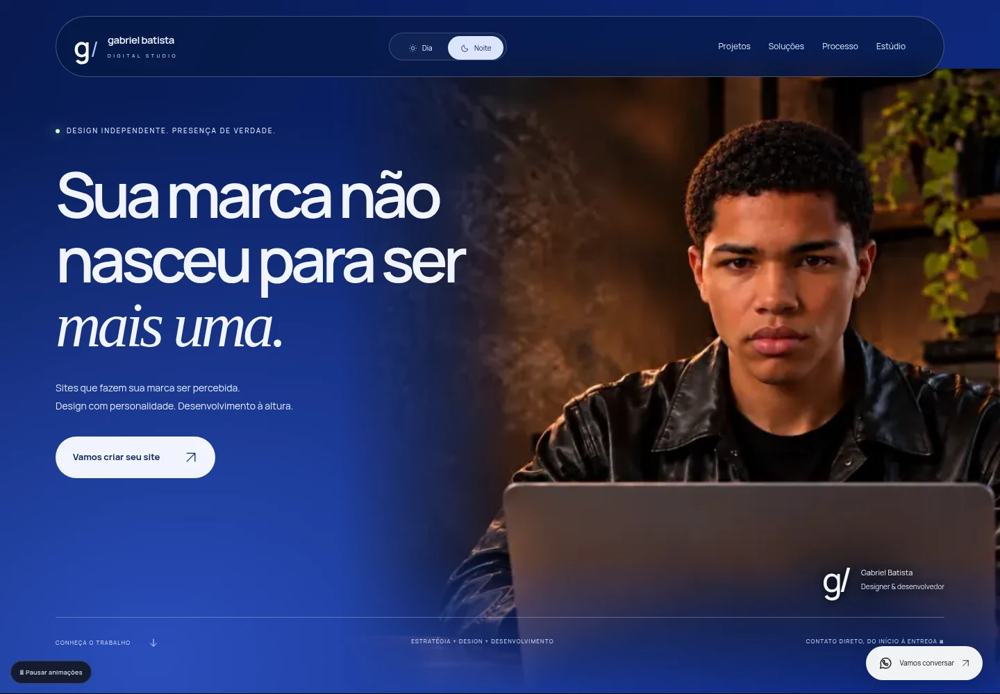

# Gabriel Batista Digital

Portfólio e contato direto. Next.js 16 App Router, React, TypeScript e Tailwind CSS 4. WhatsApp exclusivo: https://wa.me/5538998267717.



[Dia](docs/preview/signature-light.webp) · [Celular](docs/preview/signature-mobile.webp) · [Projetos](docs/preview/signature-work.webp)

## Executar

Node.js 22+. Use a pasta que contém package.json:

```sh
npm ci
npm run dev
```

Confira a porta no terminal. Preserve servidores de outros projetos. Para verificar:

```sh
npm run lint
npm run build
npm run typecheck
npx playwright install --with-deps chromium
npm run test:e2e -- --reporter=list,html
```

Os testes iniciam o build de produção na porta 3107. Deixe a porta disponível. Chromium local pode ser definido por PLAYWRIGHT_CHROMIUM_EXECUTABLE. As gravações também precisam do FFmpeg instalado pelo Playwright. Relatórios gerados não são arquivos fonte e ficam fora do lint e do Git.

## Página principal atual

Veja [a direção e a revisão integral](docs/REVISAO-SIGNATURE.md).

Abertura azul com fotografia preservada, proposta breve, seis projetos em destaque, catálogo expansível dos 20 projetos, soluções, processo, apresentação, FAQ e contato. Uma nota identifica os estudos autorais; não há números de clientes ou resultados inventados.

- components/SignatureHome.tsx: composição da página.
- components/SelectedWork.tsx: seleção, movimento e catálogo de nichos.
- app/signature.css: direção visual e responsividade da homepage.
- components/sections/Services.tsx: soluções com navegação acessível.
- components/sections/Contact.tsx: contato e orientação contextual.
- components/ScrollExperience.tsx: progresso nativo e pausa.
- public/images/hero/gabriel-contact.webp: fotografia escolhida pelo usuário.

Os componentes antigos da hero e da vitrine permanecem arquivados, sem serem renderizados. Não voltar à sequência de poses. Textos históricos de revisões anteriores não descrevem a homepage atual.

## Projetos

As rotas /conceitos/chronos-atelier, /conceitos/vanguard e /conceitos/aura-aesthetics continuam preservadas. Existem 17 rotas /modelos/[slug] para jurídico, agro, saúde, patrimônio, empresas e experiências. As marcas e pessoas das demonstrações são fictícias. São estudos de design e desenvolvimento, sem estoque, reservas ou atendimento profissional real. O contato comercial é sempre Gabriel, desenvolvedor.

Conteúdo em lib/content.ts, lib/models.ts e lib/model-brands.ts. Capturas em public/images/screens/ e public/images/models/previews-branded/. A calculadora de energia é uma orientação local; não promete economia nem substitui dimensionamento.

## Fluxo compartilhado

Use [docs/FLUXO-GITHUB.md](docs/FLUXO-GITHUB.md) para sincronizar com o Antigravity preservando as alterações locais. Trabalhe pela branch revisao-site. A main fica preservada. O workflow executa testes e guarda capturas, vídeos e relatório, sem deploy automático. Testes aprovados não significam aprovação estética.

A API antiga de assistente está desativada. Não é necessária nenhuma chave para rodar a página.

## Skills do workspace

Instaladas `frontend-design` e `webapp-testing` em `.agent/skills/`, com fonte e licenças preservadas. Veja [como ativar e usar](docs/SKILLS-DESIGN.md). A última direção visual foi rejeitada; os próximos ajustes devem partir de uma crítica e de composições concretas, sem tratar a página atual como aprovada.
